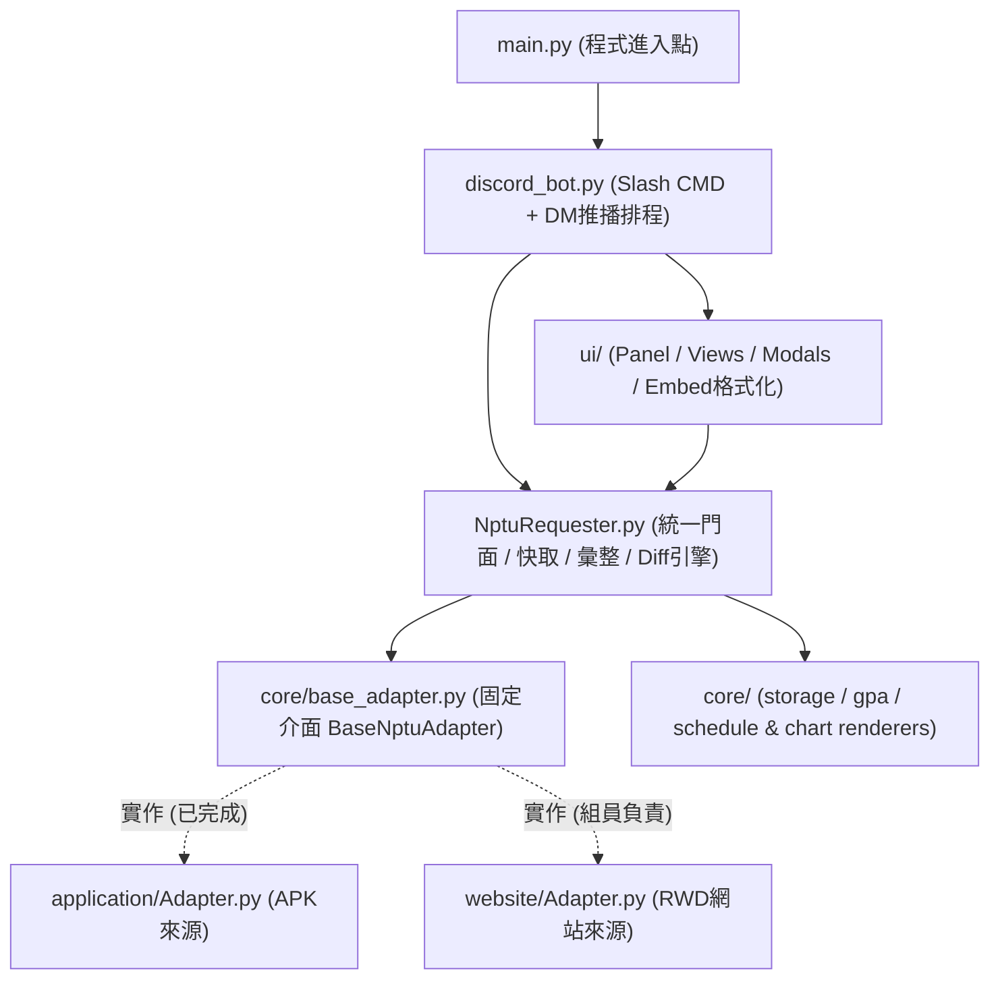

# `nptu_bot` 專案架構與協作開發指南（含 AI 協作規範）

> 本文件說明 `nptu_bot` 的整體架構、每個檔案的職責、已固定的資料結構規格（Data Contract），以及協作組員（負責 `website/` 來源）與 AI 助理在開發時**「哪裡可以改、哪裡不能改」**的明確邊界。

---

## 1. 系統分層架構

本專案採用 **Facade + Adapter 模式**：
* **前端與排程層 (`discord_bot.py` + `ui/`)**：只負責 Discord Slash Commands、Embed 互動面板與 DM 推播，**完全不碰任何 HTTP 請求或爬蟲邏輯**。
* **統一門面層 (`NptuRequester.py`)**：接收 Bot 呼叫，依 `.env` 的 `NPTU_DEFAULT_SOURCE`（`application` 或 `website`）路由到對應的 `Adapter.py`，並統一負責 SQLite 快取、跨學期彙整、GPA 計算、折線圖／課表繪圖與異動比對。
* **資料來源適配層 (`application/` & `website/`)**：各自實作 `core/base_adapter.py` 定義的 `BaseNptuAdapter` 抽象介面，將不同來源（行動屏大 APK vs 行動屏大 RWD 網站）的原始回傳轉換成**完全一致的資料結構**。



---

## 2. 🚨 協作修改紅綠燈守則（給組員與 AI 助理）

如果你是負責開發 **`website/`（行動屏大 RWD 網站來源）** 的組員，或你正在讓 AI（GPT / Claude / Cursor / Copilot 等）幫你寫程式，**請務必先將本守則提供給 AI**：

| 燈號 | 路徑 | 權限說明 |
| :---: | :--- | :--- |
| 🟢 **可自由修改與新增** | `website/` 底下所有檔案（例如 `website/Adapter.py`、新增 `website/client.py`、`website/parser.py`、`website/constants.py`） | **你的主要開發區。** 只要 `website/Adapter.py` 完整實作 `BaseNptuAdapter` 並遵守第 4 節的回傳欄位規格，內部要怎麼爬蟲、管 Cookie/Session、解析 HTML 或 JSON 皆可自由設計。 |
| 🟡 **需先溝通再改** | `requirements.txt`、`.env.example`、`NptuRequester.py` | • 若 `website/` 需要新套件（如 `beautifulsoup4`、`lxml`），請補到 `requirements.txt` 並通知。<br>• 若需要額外環境變數，請加到 `.env.example`（**嚴禁提交 `.env`**）。<br>• `NptuRequester.py` 已經支援路由到 `"website"`，原則上不需修改。 |
| 🔴 **禁止修改（已鎖定）** | `application/`、`core/`、`ui/`、`discord_bot.py`、`main.py` | **資料結構與前後端介面皆已固定並通過實機驗證。** 請勿為了配合網站原始格式而修改 `ui/formatters.py` 或 `NptuRequester.py`；正確做法是在 `website/Adapter.py` 內將網站資料**轉換成第 4 節規定的標準欄位名稱**。 |

---

## 3. 全專案檔案職責一覽

### 根目錄
| 檔案 | 職責說明 | 注意事項 |
| :--- | :--- | :--- |
| `main.py` | 程式進入點：載入 `.env`、設定 logging、初始化 `NptuRequester` 與啟動 `NptuBot`。 | 🔴 鎖定。 |
| `discord_bot.py` | 註冊所有 Discord Slash Commands（`/panel`, `/schedule`, `/score`, `/attendance`, `/leave`, `/reward`, `/alert`, `/course`, `/library`, `/classroom`, `/notify`, `/auth`）與背景 DM 推播排程 (`tasks.loop`)。 | 🔴 鎖定。個人功能限 `DISCORD_OWNER_ID`，公開功能所有人皆可使用。 |
| `NptuRequester.py` | 統一門面：管理 `application` 與 `website` 兩個 Adapter、SQLite 快取、跨學期（學期／學年／在學期間）彙整、GPA 趨勢計算與成績／請假異動 Diff 引擎。 | 🟡 原則鎖定。所有 Bot 請求必經此檔。 |
| `requirements.txt` | 本機 Conda 環境所需的 pip 套件清單。 | 🟡 新增爬蟲依賴時可補充。 |
| `.env.example` | 環境變數範本。 | 🟡 切勿把真實帳密、Token 或金鑰寫進來。 |
| `.gitignore` | 排除 `.env`、`data/`、`temp_data/`、Python 快取。 | 確保 `temp_data/` 與 `data/` 永不上傳 GitHub。 |

### `core/`（共用核心 — 🔴 鎖定）
| 檔案 | 職責說明 | 注意事項 |
| :--- | :--- | :--- |
| `core/base_adapter.py` | 定義 `BaseNptuAdapter` 抽象基類、`NPTUError`/`NPTUAuthError` 例外，以及 `TempDataDumper`（自動將每次抓回的原始資料脫敏後存成 JSON 到 `temp_data/`）。 | **`website/Adapter.py` 必須繼承 `BaseNptuAdapter`。** |
| `core/storage.py` | 執行緒安全的 SQLite 儲存層 (`data/nptu_bot.sqlite3`)，管理 `auth_state`（依 `source` + `student_id` 分開存）、`api_cache`、`notify_snapshots`、`bot_settings`。 | `website` 可直接呼叫 `self.storage.save_auth("website", ...)` 存登入狀態。 |
| `core/gpa.py` | 屏大官方 4.0 等第績分換算（`A:80~100=4.0`、`B:70~79=3.0`、`C:60~69=2.0`、`D:50~59=1.0`、`E:1~49=0`、`X:0=0`）與加權平均統計。 | 依賴成績物件中的 `score`、`credits`、`pass_TXT`。 |
| `core/schedule_renderer.py` | Pillow 深色高畫質課表 PNG 繪圖器（自動 5/7 天、連堂合併、必選修雙色、自動偵測系統中文字體）。 | 依賴課表物件中的 `week_ID`、`lesson_ID`、`plan_OPEN_ID`、`subj_CNAME`、`room_CNAME`、`must_TXT`。 |
| `core/score_chart_renderer.py` | Pillow 深色高畫質「歷年學期成績平均趨勢折線圖」繪圖器。 | 由 `NptuRequester.get_score_trend()` 呼叫。 |

### `application/`（來源一：行動屏大 APK — 🔴 鎖定）
| 檔案 | 職責說明 | 注意事項 |
| :--- | :--- | :--- |
| `application/constants.py` | APK 端點清冊 (`API_CATALOG`)、節次對照 (`TIME_SLOTS`, `LESSON_MAP`)、選課階段 (`PHASE_MAP`)、請假假別與節次代碼對照 (`LEAVE_TYPE_MAP`, `LEAVE_LESSON_NAME_TO_ID`)。 | 已依實機回傳驗證完成。 |
| `application/crypto.py` | 3DES-ECB + PKCS7 + JS `encodeURIComponent` 路徑加密。 | 金鑰僅從 `.env` 的 `NPTU_APP_3DES_KEY` 讀取，零硬編碼。 |
| `application/client.py` | `httpx.AsyncClient` 非同步請求層，實作 OAuth 自動登入、903 刷新、902 重登、公私端點分流，以及寫入 `temp_data/`。 | 已修正明文 POST 傳參與 `profile` 持久化。 |
| `application/Adapter.py` | 實作 `BaseNptuAdapter`，已處理 `errorCode=310`（查無資料轉為 `[]`/`None`）與 `student_leave_list` 的 `data["leaveList"]` 解包。 | 可作為 `website/Adapter.py` 的最佳範本參考。 |

### `website/`（來源二：行動屏大 RWD — 🟢 組員開發區）
| 檔案 | 職責說明 | 注意事項 |
| :--- | :--- | :--- |
| `website/Adapter.py` | `WebsiteAdapter` 實作（並保留別名 `Adapter = WebsiteAdapter`）。目前已建好所有方法骨架，未實作前拋出 `NotImplementedError`。 | **請在此完成實作**，可依需要於 `website/` 內拆分 `client.py`、`parser.py` 等輔助模組。 |

### `ui/`（Discord 互動介面 — 🔴 鎖定）
| 檔案 | 職責說明 | 注意事項 |
| :--- | :--- | :--- |
| `ui/panel.py` | `/panel` 主控台按鈕面板（第一排個人校務限 Owner、第二排公開查詢所有人可用）。 | — |
| `ui/views_personal.py` | 課表、成績（含學期／學年下拉選單與折線圖按鈕）、缺曠、請假（含 Modal 與二次確認按鈕）、獎懲／預警互動 View。 | — |
| `ui/views_public.py` | 課程查詢（含每堂課專屬快速詳情按鈕與每週進度切換）、圖書查詢、教室查詢互動 View。 | — |
| `ui/formatters.py` | 所有 Embed 排版函式。 | **所有欄位名稱以此檔讀取的 Key 為最終標準（見第 4 節）。** |

---

## 4. `website/Adapter.py` 固定資料結構規格（Data Contract）

> [!IMPORTANT]
> `website/Adapter.py` 的每個方法都必須是 **`async def`**（請使用 `httpx.AsyncClient`，**切勿使用同步 `requests`** 以免卡死 Discord Bot 心跳）。
> 若某學期查無資料，請回傳 **`[]`**（清單型方法）或 **`None`**（物件型方法），**不要拋出例外**。

### A. 開發必守規則
1. **類別與別名**：保留 `class WebsiteAdapter(BaseNptuAdapter)`、`source_name = "website"` 與模組底部 `Adapter = WebsiteAdapter`。
2. **保留原始抓包到 `temp_data/`**：每次從網站抓回原始回應時，呼叫：
   ```python
   self.dumper.dump(self.source_name, endpoint_name, raw_payload, params=params)
   ```
   `TempDataDumper` 會自動遮罩密碼／Token 並存成 `temp_data/website_<endpoint>.json`。
3. **公私端點分流**：標記「免登入」的方法（課程、教室、圖書、校園地點）**不可要求或觸發個人帳號登入**。
4. **錯誤處理**：登入失敗請拋出 `NPTUAuthError`；一般網路或系統錯誤請拋出 `NPTUError`；尚未實作的端點可暫時保留 `raise NotImplementedError(...)`。

---

### B. 各方法必要回傳欄位對照表

#### 1. 登入與個人資料
* `async def login(self, force: bool = False) -> dict[str, Any]`
  * 回傳：`{"profile": {"std_CNAME": "學生姓名", ...}, "logged_in": True}`
* `def get_profile(self) -> dict[str, Any]`
  * 至少包含：`std_CNAME`（顯示於面板與課表／成績標題）。

#### 2. 學期清單：`get_semesters() -> list[dict]`
每筆元素需包含：
```json
{
  "syear": "115",
  "seme": "1",
  "default": "yes",
  "default_PHASE": "4",
  "syse_TXT": "115學年第1學期"
}
```
* `default`：當學期請設為 `"yes"`，其餘 `"no"`（`NptuRequester` 依此決定預設學期）。
* `seme`：`"1"` 上學期、`"2"` 下學期、`"3"` 暑期。

#### 3. 個人成績：`get_scores(year, term) -> list[dict]`
每筆科目需包含：
```json
{
  "syear": "113",
  "seme": "2",
  "subj_ID": "COS2007",
  "subj_CN": "資料結構",
  "score": "95.0",
  "score_TXT": "95",
  "credits": "3.0",
  "pass_TXT": "是",
  "course_CNAME": "專業",
  "must_TXT": "必",
  "sco_AVG": "學業平均：88.13  班級名次：8/51  已取得累計學分：46    操行成績：86"
}
```
* `score` / `score_TXT`：若尚未結算請給 `""`。
* `sco_AVG`：系統會自動以正則擷取其中的 `班級名次：X/Y`（單學期顯示於 Footer）與 `操行成績：Z`（單學期 Footer 與學年／在學總表）。

#### 4. 個人課表：`get_courses(year, term, phase) -> list[dict]`
每筆節次（一堂課若有 3 節會拆成 3 筆或每節一筆）需包含：
```json
{
  "week_ID": "1",
  "lesson_ID": "01",
  "plan_OPEN_ID": "1151000880",
  "subj_CNAME": "大數據分析程式設計",
  "room_CNAME": "五育樓203",
  "must_TXT": "必",
  "divs_CNAME": "電腦科學系"
}
```
* `week_ID`：`"1"`~`"7"`（週一～週日）。
* `lesson_ID`：`"M"`, `"01"`~`"09"`, `"N"`, `"A"`~`"D"`（`"1"`~`"9"` 也會自動補零）。
* `plan_OPEN_ID`：同一天相同的 `plan_OPEN_ID` 會被繪圖器自動合併成連堂卡片。

#### 5. 缺曠課統計：`get_leave_statistics(year, term) -> list[dict]`
每筆課程需包含：
```json
{
  "syear": "115",
  "seme": "1",
  "subj_ID": "COS3051",
  "subj_CNAME": "大數據分析程式設計",
  "leave_HOURS": "3",
  "abwol_HOURS": "0",
  "subj_TOTAL_HOURS": "54"
}
```
* `leave_HOURS`：請假節數；`abwol_HOURS`：曠課節數。

#### 6. 缺曠課紀錄（假單明細）：`get_leave_list(year, term, status="") -> list[dict]`
每筆紀錄需包含：
```json
{
  "excuse_DT": "115-10-29",
  "excuse_TXT": "公假",
  "cutclass_TXT": "",
  "cutclass_ID": "",
  "subj_CN": "大數據分析程式設計",
  "lesson_ID": "05,06,07",
  "check_M_TXT": "已核定",
  "reason": "參訪活動",
  "open_ID": "1151000880"
}
```
* 若為**曠課**，請讓 `cutclass_TXT`（如 `"曠課"`）或 `cutclass_ID` 非空，系統會自動歸類為「曠課」。
* `check_M_TXT` 同時用於背景 DM 推播偵測審核狀態變更。

#### 7. 請假申請與查詢
* `get_leave_ask_list(status="A") -> list[dict]`：每筆含 `excuse_DT`（8 碼 `YYYYMMDD`）、`excuse_ID`（`B`/`C`/`F`/`J`）、`syear`、`seme`、`reason`、`lesson_ID`。
* `get_leave_basic_data() -> dict`：
  ```json
  {
    "leaveTypeList": [{"EXCUSE_ID": "B", "EXCUSE_ID_TXT": "事假"}],
    "lessonList": [{"LESSON_ID": "1", "LESSON_CNAME": "01", "BTIME": "08:00", "ETIME": "08:50"}]
  }
  ```
* `submit_leave(excuse_date, lesson_ids, excuse_id, reason, file_base64="", file_type="jpg") -> dict`：
  * 傳入的 `excuse_date` 已正規化為 8 碼 `YYYYMMDD`。
  * 回傳：`{"result": True/False, "data": {"errorCode": "...", "errorDescription": "..."}, "reason": "..."}`。

#### 8. 個人獎懲 & 學習預警
* `get_rewards() -> list[dict] | Any`
* `get_score_alerts(year, term) -> list[dict] | Any`
  * 目前 UI 支援通用欄位自動排版，實機抓到結構後可透過 `temp_data/` 確認並統一。

#### 9. 免登入公開查詢（課程 / 教室 / 圖書）
* `get_course_year_term() -> list[dict]`：至少含 `syear`、`seme`。
* `query_school_courses(year, term, **filters) -> list[dict]`：
  ```json
  {
    "open_ID": "1151002143",
    "subj_CNAME": "量子力學導論(一)",
    "emp_CNAME": "郭柏辰",
    "room_CNAME": "敬業樓407 (46人)",
    "week_CNAME": "[3]",
    "lesson_CNAME": "[050607]",
    "credits": "3.0",
    "show_CLASS": "應物系",
    "must_TXT": "選",
    "stds_Y": "31",
    "std_MAX": "46"
  }
  ```
* `get_course_detail(open_id) -> list[dict] | dict`：
  * 支援欄位：`subj_CNAME`, `subj_ENAME`, `subj_ID`, `open_ID`, `emp_CNAME`, `show_CLASS`, `must_TXT`, `credits`, `hours`, `tchtype_TXT`, `lang1`, `lang2`, `lang3`, `score_WAY`, `target`, `outcomes`, `mastread`, `reference`, `othermm`, `syllabus`。
* `get_locations()` / `get_map_poi()`：回傳校園建築／地點清單（供 `/classroom` 使用）。
* `search_library_books(qtype, qtext, page=1)` / `get_library_book_detail(bib_ids)` / `get_library_open_time(month="")`：回傳館藏清單（含 `title`, `author`, `publisher`, `bibId`）與開館時間。

---

## 5. 如何開發與測試 `website/` 來源

1. **獨立單測（不啟動 Discord Bot）**：
   ```python
   import asyncio
   from dotenv import load_dotenv
   from NptuRequester import NptuRequester

   load_dotenv()

   async def main():
       req = NptuRequester(default_source="website")
       try:
           print(await req.get_semesters())
       finally:
           await req.close()

   asyncio.run(main())
   ```
2. **切換整個 Discord Bot 使用 `website` 來源**：
   修改本機 `.env` 中的：
   ```ini
   NPTU_DEFAULT_SOURCE=website
   ```
   重新執行 `python main.py`，所有 Slash Commands 與 `/panel` 都會自動改走 `website/Adapter.py`，完全不需改動任何 Bot 或 UI 程式碼。
3. **驗證資料結構**：執行測試後請檢查 `temp_data/website_*.json`，並比對 `temp_data/application_*.json` 確認關鍵鍵名一致。
